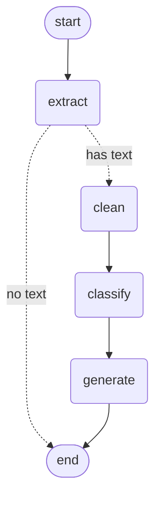

# EduVision

Backend service that analyses an image of educational content. You upload a photo of a textbook
page, worksheet or hand-drawn diagram, and EduVision returns the extracted text, a classification
(subject, topic, content type, difficulty) and a student-friendly explanation, with an optional
Mermaid diagram. Each analysis is stored and can be fetched again later.

It is built with Python 3.12, FastAPI, SQLite (SQLModel), and a LangGraph workflow that calls a
vision-capable Claude model. The specs in `specs/` (`requirements.md`, `design.md`, `tasks.md`)
are the source of truth.

## Architecture

```
src/eduvision/
  api/        HTTP only: routers, parsing, status codes, error bodies
  services/   orchestration: load data, run the workflow, save the result
  workflow/   LangGraph pipeline; image in, result out (no HTTP, no database)
  llm/        the only place the chat model is created (tests inject a fake)
  db/         repositories: the only code that touches the database
  storage/    uploaded files on local disk
  schemas/    Pydantic models for API responses and LLM outputs
```

### Workflow

Each analysis runs a fixed LangGraph pipeline: extract the text (and a short description of any
layout), clean the text, classify it, then generate the explanation.



The dotted edges are the conditional exit after extraction: when no text is found, the workflow
stops there and the analysis fails with `no_text_found`. The extract step keeps visible text
(`text`) separate from descriptions of arrows and shapes (`layout`); later steps use the layout
only to understand how the ideas relate.

## Setup

Requires [uv](https://docs.astral.sh/uv/) and Python 3.12.

```bash
uv sync
cp .env.example .env   # then set LLM_MODEL and ANTHROPIC_API_KEY
```

## Configuration

Settings are read from `.env` or the environment (`config.py`). Every variable is listed in
`.env.example`.

| Variable | Default | Description |
|---|---|---|
| `LLM_PROVIDER` | `anthropic` | `anthropic` or `fake` |
| `LLM_MODEL` | none | Vision-capable model ID; required for `anthropic` |
| `ANTHROPIC_API_KEY` | none | Required for `anthropic`; never logged |
| `LLM_TIMEOUT_SECONDS` | `60` | Per-call timeout |
| `LLM_MAX_RETRIES` | `2` | SDK retries for transient errors (connection, 5xx, 429) |
| `WORKFLOW_RECURSION_LIMIT` | `10` | Maximum workflow steps per analysis |
| `UPLOAD_DIR` | `./data/uploads` | Where uploaded images are stored |
| `MAX_UPLOAD_BYTES` | `10485760` | Upload size limit (10 MB) |
| `DATABASE_URL` | `sqlite:///./data/eduvision.db` | SQLite database |
| `LOG_LEVEL` | `INFO` | Logging level |

With `LLM_PROVIDER=fake` the server starts without an API key, which is handy for local work, but
analysis requests don't work in that mode. Only tests can inject a fake model.

**There is no migration tool.** After a schema change (for example the `layout` column), delete the
dev database (`data/eduvision.db`); it is recreated on the next start.

## Run

```bash
uv run uvicorn eduvision.main:create_app --factory --reload
```

The server refuses to start unless `LLM_MODEL` and `ANTHROPIC_API_KEY` are set. Open
<http://127.0.0.1:8000/docs> to upload an image and run an analysis from the browser.

## Test

Stop any running dev server first: the test suite fails if `./data` changes while it runs.

```bash
uv run pytest
uv run ruff check .
uv run ruff format --check .
uv run mypy src
```

The tests use a scripted fake model and never call the real API.

## Smoke test (real model)

`scripts/smoke_test.py` uploads the sample images and analyses them with the model from `.env`. It
is not part of pytest, and it makes real, billed API calls (about 4 per image that has text).

1. Add your own images to `samples/` as described in `samples/README.md` (`printed`, `handwritten`,
   `no_text`, `diagram`). The images are git-ignored.
2. Run it (a missing sample is skipped):

```bash
uv run python scripts/smoke_test.py            # all samples
uv run python scripts/smoke_test.py diagram    # only the named samples
```

It prints, per sample, the status, failure reason, extracted text, layout, classification,
explanation, token counts and duration. It writes to the configured database and upload directory.

## Example

Upload an image, then analyse it:

```bash
curl -F "file=@samples/diagram.jpeg" http://127.0.0.1:8000/api/v1/uploads
# {"upload_id": "5f0c...", "original_filename": "diagram.jpeg", "content_type": "image/jpeg", ...}

curl -X POST http://127.0.0.1:8000/api/v1/analyses \
  -H "Content-Type: application/json" \
  -d '{"upload_id": "5f0c..."}'
```

Response (`201`, abridged):

```json
{
  "analysis_id": "9a1e...",
  "upload_id": "5f0c...",
  "status": "completed",
  "failure_reason": null,
  "extracted_text": "Cloud\nRain\nWater",
  "layout": "A cloud at the top with drops falling below it, then an arrow pointing right to the word Rain. Wavy upward arrows rise from a water body at the bottom toward the cloud.",
  "classification": {
    "subject": "science",
    "topic": "water cycle",
    "content_type": "diagram",
    "difficulty": "beginner"
  },
  "explanation": {
    "title": "How Water Moves Through the Water Cycle",
    "summary": "Water on Earth keeps moving between places in a cycle. ...",
    "key_points": ["...", "...", "..."],
    "examples": ["For example, a puddle or lake warms in the sun, and some of its water rises into the air."],
    "diagram_mermaid": "flowchart LR\n  W[\"Water\"] -->|\"water rises\"| C[\"Cloud\"]\n  C -->|\"water falls\"| R[\"Rain\"]\n  R -.->|\"flows back (not shown)\"| W"
  },
  "usage": { "input_tokens": 8308, "output_tokens": 803, "duration_ms": 8563 },
  "created_at": "...",
  "updated_at": "..."
}
```

In `diagram_mermaid`, solid edges are relationships present in the image; a dotted edge labelled
"(not shown)" is inferred.

### Endpoints

| Method and path | Purpose |
|---|---|
| `GET /health` | Liveness check |
| `POST /api/v1/uploads` | Upload a JPEG, PNG or WebP image (max 10 MB) |
| `POST /api/v1/analyses` | Analyse an upload: `{"upload_id": "..."}` |
| `GET /api/v1/analyses/{id}` | Fetch one analysis |
| `GET /api/v1/analyses?limit=20&offset=0` | List analyses, newest first |

Errors use one format, `{"error": {"code": "...", "message": "..."}}`. A failed analysis is saved
and its error also carries an `analysis_id`: `no_text_found` is `422`, `llm_unavailable` is `502`,
and `invalid_llm_output`, `step_limit_exceeded` and `internal_error` are `500`.

## Future phases

| Phase | Scope |
|---|---|
| 2 | Langfuse tracing; token budget per analysis |
| 3 | RAG over curriculum materials (Pinecone or Chroma) in the Generate step |
| 4 | Confidence check after Extract, with human-in-the-loop review via LangGraph `interrupt()` |
| 5 | Eval harness (fixed test images, accuracy / latency / cost report) |
| 6 | Next.js frontend |
| 7 | Deployment (Docker, cloud hosting, CI/CD) |
| Later | Downscale large images before sending them to the model |
| Later | Validate Mermaid output before storing it |
